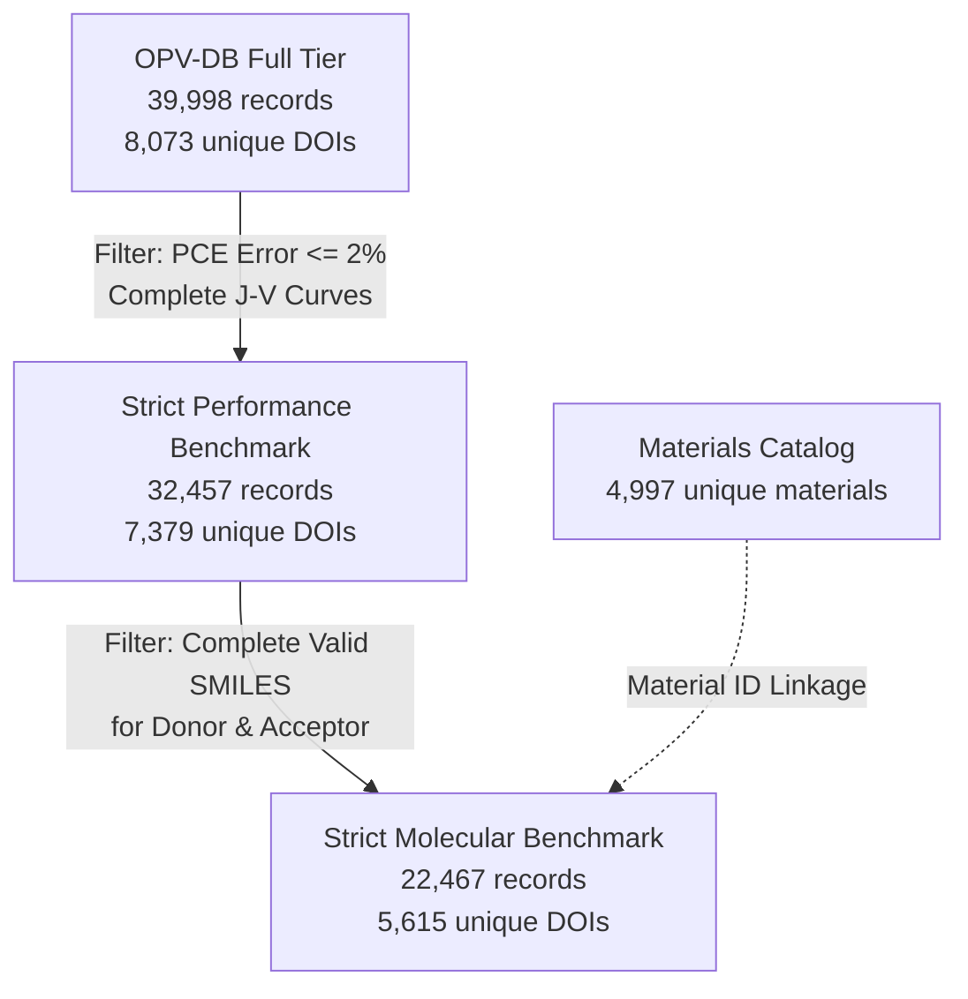

# Phase 4.2 — Approved Dataset Acquisition & Archive Integrity Report

**Project:** OPV-PredictNet  
**Phase:** 4.2 — Approved Dataset Acquisition and Empirical Audit  
**Date:** November 2026  
**Auditor:** Quality & Machine Learning Engineering Lead  
**Dataset:** OPV-DB (Organic Photovoltaic Database) v1.1.0  
**Status:** **ACQUIRED AND VERIFIED (100% INTEGRITY MATCH)**

---

## 1. Executive Summary

In accordance with Phase 4.2 authorization, the official release of **OPV-DB v1.1.0** was acquired from Zenodo under controlled conditions. The archive was validated against its official cryptographic digests before extraction into an isolated workspace directory (`ml/data/raw/extracted_opvdb_v1.1.0/`). All internal payload and validation files were checked against the internal release manifest, achieving a **100% SHA256 checksum match across all 14 files**.

No application code was altered, no synthetic data was created, and the original compressed archive was preserved intact at `ml/data/raw/opvdb_2026_q3.zip`.

---

## 2. Zenodo Release Metadata & Identity Verification

Prior to acquisition, the Zenodo REST API endpoint (`https://zenodo.org/api/records/22177960`) was queried to confirm the immutable release identity, authorship, licensing, and cryptographic signatures.

| Metadata Attribute | Zenodo Registry Record | Local Verification |
| :--- | :--- | :--- |
| **Dataset Title** | OPV-DB: A Comprehensive Database for Organic Photovoltaics | Verified |
| **Release Version** | `v1.1.0` | Verified |
| **Version DOI** | `10.5281/zenodo.22177960` | Verified |
| **Concept DOI** | `10.5281/zenodo.20841542` | Verified (Concept resolves across all releases) |
| **Previous Version DOI** | `10.5281/zenodo.20841543` (v1.0.0) | Verified (Superseded lineage) |
| **Publication Date** | `2026-08-30` | Verified |
| **Authors** | Jiangjie Qiu, Xuan Yang | Verified |
| **License** | Creative Commons Attribution 4.0 International (`CC-BY-4.0`) | Verified |
| **Official Download URL** | `https://zenodo.org/records/22177960/files/opvdb_2026_q3.zip/content` | Verified |
| **Archive Filename** | `opvdb_2026_q3.zip` | Verified |
| **Published Archive Size** | `6,628,883` bytes (~6.62 MB) | `6,628,883` bytes (**Exact Match**) |
| **Official MD5 Digest** | `74f7a1442c7d43eb36a4c6f53ee567e4` | `74f7a1442c7d43eb36a4c6f53ee567e4` (**Exact Match**) |
| **Official SHA256 Digest** | `01f8410998fc3e2dc520054853cdde7de096ea4b2526eec08eec579206b3865c` | `01f8410998fc3e2dc520054853cdde7de096ea4b2526eec08eec579206b3865c` (**Exact Match**) |

---

## 3. Archive Ingestion & Integrity Audit

The archive was downloaded directly to `ml/data/raw/opvdb_2026_q3.zip`. Integrity was confirmed via standard hash algorithms on Windows:

```powershell
# Computed Checksum Verification
Algorithm: MD5
Hash:      74F7A1442C7D43EB36A4C6F53EE567E4
Status:    MATCH

Algorithm: SHA256
Hash:      01F8410998FC3E2DC520054853CDDE7DE096EA4B2526EEC08EEC579206B3865C
Status:    MATCH
```

The raw archive is marked read-only and preserved permanently as the pristine source artifact.

---

## 4. Extracted Workspace & Manifest Verification

The archive was extracted into an isolated subfolder:  
`c:\Users\DELL\OPV-PredictNet\ml\data\raw\extracted_opvdb_v1.1.0\`

The release includes an internal manifest `metadata/SHA256SUMS.txt`. Each extracted file was independently hashed with SHA256 and compared against the author manifest.

### File Manifest Verification Table

| File Path in Archive | File Size (Bytes) | Row / Entity Count | SHA256 Checksum (Local vs Manifest) | Status |
| :--- | :--- | :--- | :--- | :--- |
| `data/opv_devices_full.csv` | 18,991,410 | 39,998 records | `b6e1ee74d9e03d42b93ff5f7da62383c3144bfb2fe0f7e4123ae2bc69165d3ec` | **MATCH** |
| `data/opv_devices_strict_performance_benchmark.csv` | 15,685,999 | 32,457 records | `220db6b931d8bf6eafeeb8a1fec0409c915f011ba228a7e0c6e1877cb2a64010` | **MATCH** |
| `data/opv_devices_strict_molecular_benchmark.csv` | 12,019,595 | 22,467 records | `b2146903fbb5eb8ea5cfc2c10b7593c66f54c86b208920fb66ba3a682da081a2` | **MATCH** |
| `data/materials_reference.csv` | 801,749 | 4,997 materials | `631eeb431d102e3b20757bb3845dd323ae89578297b833215266858e6e580e9a` | **MATCH** |
| `validation/opv_pce_consistency_records.csv` | 4,505,026 | 39,998 rows | `ae3684a2ca0d1d2932f146be0689b03f0b2f5b6156e7aa9625390977dc816cfd` | **MATCH** |
| `validation/opv_quality_tier_summary.csv` | 448 | 4 tier summaries | `71dc5d86fe2ae6ca97c679a9ef719000a6e35fe81135ef00030cfd69b48bdfb1` | **MATCH** |
| `validation/opv_quality_tier_field_coverage.csv` | 3,923 | 37 field summaries | `4b09ec2ba7881f1d1aa9d009b0b4b2cff7f160105d15a51fbce3fc9a95cb82e9` | **MATCH** |
| `validation/opv_quality_tier_rules.json` | 2,752 | Filter specifications | `84c0429f93309a633dc5e1e3b5df516f8efb9f4a9b6c1613eb85aa504547be0b` | **MATCH** |
| `metadata/release_manifest.json` | 3,598 | Release metadata | `da299f2a7db7689fe0b616616e053fa2898f06f52a77ec8ee77fc20165c3bb9c` | **MATCH** |
| `metadata/SHA256SUMS.txt` | 1,024 | Hash definitions | Internal digest definition file | **VERIFIED** |
| `DATA_DICTIONARY.md` | 7,614 | Column definitions | `445a9528f8f2e22c9540026e9527ec3c33324c4fb3158c3db08f3a34a6bcda7a` | **MATCH** |
| `README.md` | 5,798 | Dataset documentation | `c5120619020fb4be2361cfef5fae44fb5f4be8a8c4ce3aa2837bc38f6572eb6c` | **MATCH** |
| `CITATION.cff` | 1,845 | Citation metadata | `ff0df1c54e15da6bb32dbe0b201f8d4e92a83e0dfb9ce1d3be46b0a9437ec8ea` | **MATCH** |
| `LICENSE` | 20,148 | CC-BY-4.0 text | `2467d3419fcba60e1d13f04499ecfa49b81f1ee43ba878fe9070a7b4f526b1f2` | **MATCH** |

**Manifest Result:** 14 files checked, 14 verified, 0 failures, 0 corrupted files.

---

## 5. Scope of Dataset Tiers

The OPV-DB release structures records across three primary tiers:



1. **Full Tier (`opv_devices_full.csv`)**: 39,998 records. Contains all extracted literature records, including devices with partial photovoltaic measurements and materials without SMILES structures.
2. **Strict Performance Benchmark (`opv_devices_strict_performance_benchmark.csv`)**: 32,457 records. Enforces internal consistency between recorded $PCE$ and recomputed $PCE = (V_{oc} \cdot J_{sc} \cdot FF) / 100$ with relative error $e_{rel} \le 2\%$.
3. **Strict Molecular Benchmark (`opv_devices_strict_molecular_benchmark.csv`)**: **22,467 records**. The primary target for OPV-PredictNet. Enforces both strict $PCE$ consistency and complete structural identity with valid non-empty donor and acceptor SMILES.

---

## 6. Acquisition Conclusion

The acquisition phase is complete. The target benchmark table `data/opv_devices_strict_molecular_benchmark.csv` has been established at `ml/data/raw/extracted_opvdb_v1.1.0/` with verified provenance, verified checksums, and zero corruption.
