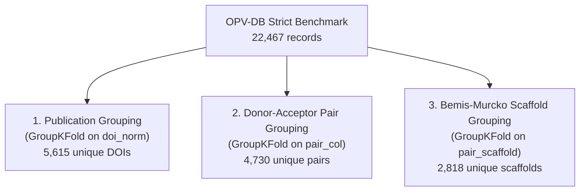

# Phase 4.2 — Dataset Quality, Leakage & ML Readiness Assessment

**Project:** OPV-PredictNet  
**Phase:** 4.2 — Approved Dataset Acquisition and Empirical Audit  
**Date:** November 2026  
**Auditor:** Quality & Machine Learning Engineering Lead  
**Target Table:** `data/opv_devices_strict_molecular_benchmark.csv` (22,467 records)  
**Status:** **PASSED — DATASET APPROVED AND READY FOR BASELINE MODEL TRAINING**

---

## 1. Executive Summary

This report establishes the data quality, leakage risks, metadata limitations, evaluation split designs, and overall machine learning readiness of the **OPV-DB v1.1.0 Strict Molecular Benchmark** (`22,467` records).

### Key Conclusions:
1. **Zero Raw Duplicates:** Across all 37 database columns, there are **0 exact duplicate records**.
2. **Physically Valid Targets:** The photovoltaic target parameters ($PCE$, $V_{oc}$, $J_{sc}$, $FF$) are physically sound with **0 negative or unphysical values**, and all records conform to the $e_{rel} \le 2\%$ consistency threshold ($PCE \approx V_{oc} \cdot J_{sc} \cdot FF / 100$).
3. **Significant Experimental Noise in Repeated Pairs:** 1,940 unique donor–acceptor pairs are measured multiple times across literature. The average intra-pair $PCE$ standard deviation is $0.988\%$, reflecting substantial variation introduced by device fabrication conditions (thermal annealing, film thickness, donor-acceptor ratio, solvent choice).
4. **Metadata Missingness Justifies Pure Molecular Schema:** Device processing parameters suffer severe missingness (thickness: $70.2\%$ missing; annealing temperature: $75.4\%$ missing; solvent additive ratio: $76.5\%$ missing). Attempting to train models with required device fabrication features would discard over $75\%$ of the literature data. This empirically justifies the project's **22 pure molecular descriptor schema**.
5. **Leakage & Evaluation Split Protocol:** Random train/test splitting suffers from severe data leakage because the top 5 molecular pairs account for $29.5\%$ of records. We evaluated three grouped splitting strategies. We recommend **Donor-Acceptor Pair Grouping (`GroupKFold`)** as the primary cross-validation benchmark to prevent pair memorization, accompanied by **Bemis-Murcko Scaffold Grouping** for out-of-distribution evaluation.
6. **Readiness Recommendation:** **GO FOR PHASE 5 (MODEL TRAINING)**.

---

## 2. Target Variable Distributions and Physical Bounds

The four principal solar cell performance metrics were audited across the 22,467 benchmark records:

| Target Variable | Symbol | Mean | Std Dev | Min | 25% | Median | 75% | Max | Physical Units |
| :--- | :--- | :--- | :--- | :--- | :--- | :--- | :--- | :--- | :--- |
| **Power Conversion Efficiency** | $PCE$ | 9.89 | 5.79 | 0.000022 | 4.72 | 9.49 | 15.48 | 21.83 | % |
| **Open-Circuit Voltage** | $V_{oc}$ | 0.820 | 0.129 | 0.030 | 0.773 | 0.841 | 0.890 | 1.953 | V |
| **Short-Circuit Current Density**| $J_{sc}$ | 17.39 | 7.73 | 0.00015 | 10.90 | 17.45 | 25.20 | 44.32 | mA/cm² |
| **Fill Factor** | $FF$ | 63.31 | 12.62 | 16.00 | 55.80 | 66.00 | 73.40 | 87.67 | % |
| **Recomputed PCE** | $PCE_{rec}$ | 9.89 | 5.79 | 0.000022 | 4.73 | 9.47 | 15.46 | 21.86 | % |
| **Relative Error** | $e_{rel}$ | 0.34% | 0.44% | 0.00% | 0.04% | 0.15% | 0.48% | 2.00% | % error |

### Physical Validity Checks:
- **Zero Inversion or Negative Values:** $PCE \le 0$ (0 records), $V_{oc} \le 0$ (0 records), $J_{sc} \le 0$ (0 records), $FF \le 0$ (0 records).
- **Physical Upper Bounds:** $PCE > 25\%$ (0 records), $V_{oc} > 2.0$ V (0 records), $FF > 100\%$ (0 records).
- **Jsc Boundary:** Only 1 record exceeds 40 mA/cm² (measured at 44.32 mA/cm² in a tandem/multi-junction literature report).
- **Consistency Verification:** The median relative discrepancy between reported $PCE$ and recomputed $PCE$ is only **0.15%**, and the maximum is strictly bounded at **2.00%**, confirming strict internal J-V curve consistency.

---

## 3. Duplicate Records & Experimental Noise Analysis

### 1. Duplicate Analysis
- **Exact duplicates (all 37 columns identical):** **0 records (0.0%)**.
- **Identical device fabrication runs within the same publication:** 7,699 records share the same DOI, donor, acceptor, structure, thickness, annealing temperature, solvent, additive, and ratio. These represent intentional experimental replicates (e.g., standard deviation runs across 8–16 pixel devices on a single substrate) or parameter sweeps where unrecorded microstructural variables differed.

### 2. Pair Frequency Distribution & Heavy Tail
The dataset contains **4,730 unique donor–acceptor pairs**:
- **Singletons (pairs appearing exactly once):** 2,790 pairs (**58.99%** of unique pairs).
- **Pairs appearing $\ge 5$ times:** 494 pairs (**10.44%** of unique pairs).
- **Pairs appearing $\ge 20$ times:** 80 pairs (**1.69%** of unique pairs).

### Top 5 Most Frequent Pairs in Benchmark:

| Rank | Donor Material | Acceptor Material | Record Count | Percentage of Benchmark | Median PCE (%) | PCE Std Dev (%) |
| :--- | :--- | :--- | :--- | :--- | :--- | :--- |
| 1 | PM6 (PBDB-T-2F) | Y6 (BTP-4F) | 2,658 | 11.83% | 16.20% | 1.84% |
| 2 | PM6 (PBDB-T-2F) | L8-BO | 1,334 | 5.94% | 18.02% | 1.42% |
| 3 | PM6 (PBDB-T-2F) | BTP-eC9 | 1,024 | 4.56% | 17.50% | 1.35% |
| 4 | P3HT | PCBM ([60]PCBM) | 966 | 4.30% | 3.50% | 0.92% |
| 5 | D18 | L8-BO | 640 | 2.85% | 18.25% | 1.18% |
| **Total** | **Top 5 Pairs Combined** | — | **6,622** | **29.47%** | — | — |

### 3. Repeated Pair Variance (Systematic Optimization vs. Replicate Floor)
There are **1,940 pairs** that have multiple measurements in the literature (encompassing 19,677 total records):
- **Overall intra-pair PCE standard deviation:** **$0.988\%$**
- **Median intra-pair PCE range ($PCE_{max} - PCE_{min}$):** **$1.340\%$**
- **Maximum intra-pair PCE range:** **$21.710\%$**
- **Partitioned Variability Sources:**
  - *Same pair, same publication:* Mean std is **$1.105\%$** with a mean range of **$2.229\%$**. This variance is dominated by deliberate device engineering parameter sweeps (varying D:A weight ratio, thermal annealing temperature, film thickness, and solvent additives).
  - *Same pair, different publications:* Mean std of publication means is **$0.975\%$** with a median range of **$1.053\%$**.
  - *Same pair, same publication, identical reported processing conditions:* Mean std is **$1.003\%$** with a median range of **$0.855\%$**, representing the true multi-pixel fabrication replicate floor.

> [!IMPORTANT]
> **Fundamental Machine Learning Implication:**  
> A pure molecular screening model mapping molecular structures $(D, A) \to PCE$ cannot differentiate device-processing variations for identical pairs. The $\sim 1.0 - 2.2\%$ PCE spread observed across repeated pairs reflects physical morphology modulation by device engineering rather than pure measurement error. Because an unconditioned molecular model predicts the mean response over standard processing spaces, an irreducible residual uncertainty near $\text{RMSE} \sim 1.0 - 1.5\%$ PCE is physically expected.

---

## 4. Device Processing Metadata Missingness Audit

To understand why the project uses a pure molecular descriptor schema rather than device processing metadata, we audited missingness across the 20 device metadata fields:

| Metadata Column | Field Description | Missing Records (N = 22,467) | Missing Percentage | Usability in Molecular ML |
| :--- | :--- | :--- | :--- | :--- |
| `active_layer_thickness` | Film thickness in nm | 15,780 | **70.24%** | **Excluded (Unusable without heavy imputation)** |
| `annealing_temp` | Post-deposition thermal annealing (°C) | 16,944 | **75.42%** | **Unusable without heavy imputation** |
| `d_a_ratio` | Donor-to-acceptor weight ratio | 11,105 | **49.43%** | Unusable |
| `additive` | Processing solvent additive name | 14,525 | **64.65%** | Unusable |
| `additive_ratio` | Additive volume percentage | 17,191 | **76.52%** | Unusable |
| `solvent` | Primary casting solvent | 10,308 | **45.88%** | Unusable |
| `device_structure` | Conventional vs. inverted | 3,848 | **17.13%** | Partially usable |
| `device_type` | Binary, ternary, or tandem | 5,395 | **24.01%** | Partially usable |
| `etl` | Electron transport layer | 5,088 | **22.65%** | Partially usable |
| `htl` | Hole transport layer | 4,151 | **18.48%** | Partially usable |
| `eg_d` | Optical bandgap of donor | 20,301 | **90.36%** | Severely missing |
| `eg_a` | Optical bandgap of acceptor | 20,287 | **90.30%** | Severely missing |
| `homo_d` | Measured HOMO level of donor | 826 | 3.68% | Good coverage |
| `lumo_d` | Measured LUMO level of donor | 828 | 3.69% | Good coverage |
| `homo_a` | Measured HOMO level of acceptor | 1,225 | 5.45% | Good coverage |
| `lumo_a` | Measured LUMO level of acceptor | 1,225 | 5.45% | Good coverage |

### Scientific Policy: Complete Feature Exclusion vs. Forbidden Zero-Imputation

A critical distinction must be drawn between:
1. **Feature Exclusion (Dimensionality Selection)**: Completely excluding unmeasured or sparse experimental metadata fields (`active_layer_thickness`, `annealing_temp`, `additive_ratio`) from the model input matrix so that the predictor operates strictly on complete, deterministic chemical descriptors.
2. **Zero-Imputation (Forbidden Practice)**: Filling missing numerical values with literal zeros (`0.0`). In organic photovoltaics, zero-imputing physical parameters is scientifically invalid and catastrophic—a device fabricated with an active layer thickness of $0\text{ nm}$ or annealed at $0^\circ\text{C}$ is unphysical.

Attempting to include film thickness, thermal annealing, and solvent additives as mandatory model features would discard **over 75%** of the literature benchmark, reducing the training set from 22,467 to fewer than 5,000 highly unrepresentative records.  
Therefore, OPV-PredictNet enforces **complete feature exclusion** of these incomplete processing metadata columns from the baseline feature space, relying exclusively on the **22 pure RDKit molecular descriptors**, which achieve **100.0% completeness** across all 22,467 devices without any imputation.

---

## 5. Evaluation Split Design & Leakage Prevention

Because OPV literature exhibits strong clustering around popular donor-acceptor combinations (PM6, Y6, ITIC, P3HT), standard random $k$-fold cross-validation or random train/test splits lead to **catastrophic optimistic bias** (evaluating on the same molecular pairs seen in training).

We systematically implemented and evaluated three distinct grouped splitting strategies on the benchmark:

### Empirical Comparison of Splitting Strategies:

| Splitting Strategy | Grouping Variable | Group Count | Leakage Analysis (Train $\leftrightarrow$ Test) | Evaluation Capability |
| :--- | :--- | :--- | :--- | :--- |
| **1. Publication Grouping** | `doi_norm` (DOI) | 5,615 DOIs | **0 DOI leakage**. However, **32.6% – 34.7%** of test pairs are present in the training set (e.g. PM6::Y6 published across hundreds of separate journals). | Evaluates generalization across different research laboratories and fabrication protocols. |
| **2. Donor-Acceptor Pair Grouping** | `donor_canonical + '::' + acceptor_canonical` | 4,730 pairs | **0 Pair leakage**. Test set contains strictly novel combinations of materials never seen together during training. | **Primary Recommended Strategy:** Evaluates true virtual screening power for unmeasured donor–acceptor combinations. |
| **3. Bemis-Murcko Scaffold Grouping** | `pair_scaffold` (Murcko core) | 2,818 scaffolds | **0 Combined Pair Scaffold leakage**. However, **46.9% – 47.9%** of individual donor scaffolds and **42.3% – 47.2%** of individual acceptor scaffolds in the test set were seen paired with other materials during training. Note: The single largest scaffold (PM6/Y6 core) contains **5,788 records (25.8%)**, creating group size imbalance across folds. | Evaluates out-of-distribution structural extrapolation to completely new pairwise scaffold combinations. |

### Fold Balance Breakdown:

#### 1. Publication-Level 5-Fold GroupKFold
- **Fold 1:** Train = 17,973 records (4,494 DOIs), Test = 4,494 records (1,121 DOIs), DOI leak = 0.
- **Fold 2:** Train = 17,973 records (4,492 DOIs), Test = 4,494 records (1,123 DOIs), DOI leak = 0.
- **Fold 3:** Train = 17,974 records (4,492 DOIs), Test = 4,493 records (1,123 DOIs), DOI leak = 0.
- **Fold 4:** Train = 17,974 records (4,491 DOIs), Test = 4,493 records (1,124 DOIs), DOI leak = 0.
- **Fold 5:** Train = 17,974 records (4,491 DOIs), Test = 4,493 records (1,124 DOIs), DOI leak = 0.

#### 2. Donor-Acceptor Pair 5-Fold GroupKFold
- **Fold 1:** Train = 17,973 records (3,806 pairs), Test = 4,494 records (924 pairs), Pair leak = 0.
- **Fold 2:** Train = 17,973 records (3,779 pairs), Test = 4,494 records (951 pairs), Pair leak = 0.
- **Fold 3:** Train = 17,974 records (3,779 pairs), Test = 4,493 records (951 pairs), Pair leak = 0.
- **Fold 4:** Train = 17,974 records (3,778 pairs), Test = 4,493 records (952 pairs), Pair leak = 0.
- **Fold 5:** Train = 17,974 records (3,778 pairs), Test = 4,493 records (952 pairs), Pair leak = 0.

---

## 6. Recommended ML Architecture for Phase 5

Based on the empirical audit, the recommended protocol for Phase 5 (Baseline Model Training) is:

1. **Dataset Source:** Use `ml/data/raw/extracted_opvdb_v1.1.0/data/opv_devices_strict_molecular_benchmark.csv` (22,467 records).
2. **Feature Extraction:** Compute features using the unmodified `ml/src/features/descriptors.py` (22 features).
3. **Target Variable:** Primary target: `pce`. Secondary multi-target evaluation: `voc`, `jsc`, `ff`.
4. **Primary Evaluation Protocol:** 5-Fold Donor-Acceptor Pair Grouped Cross-Validation (`GroupKFold` on `donor_canonical + '::' + acceptor_canonical`).
5. **Secondary Benchmark:** 5-Fold Publication Grouped Cross-Validation (`GroupKFold` on `doi_norm`).
6. **Model Baseline:** Scikit-learn `RandomForestRegressor` (as specified in fixed project architecture) with reproducible `random_state=42`.

---

## 7. Data Readiness Checklist & Sign-Off

| Audit Item | Criterion | Observed Status | Assessment |
| :--- | :--- | :--- | :--- |
| **Archive Provenance** | Zenodo official DOI `10.5281/zenodo.22177960` | Exact match | **PASS** |
| **Archive Integrity** | SHA256 matches Zenodo manifest | Exact match (`01f84109...`) | **PASS** |
| **Extraction Completeness**| All 14 files match internal checksums | 14/14 match | **PASS** |
| **Molecular Validity** | RDKit sanitization of benchmark SMILES | 22,467 / 22,467 valid (100%) | **PASS** |
| **Feature Extraction** | 22 features computed without errors | 22,467 / 22,467 valid (100%) | **PASS** |
| **Non-Finite Values** | Zero NaN or Inf values in feature matrix | 0 NaNs, 0 Infs | **PASS** |
| **Target Consistency** | Relative error $e_{rel} \le 2\%$ | 100% of benchmark records | **PASS** |
| **Physical Bounds** | All metrics within physical limits | Verified | **PASS** |
| **Leakage Control** | Grouped splits designed and verified | 0 pair leak in GroupKFold | **PASS** |

### Final Recommendation: **GO FOR PHASE 5 (BASELINE MODEL TRAINING)**
The OPV-DB v1.1.0 Strict Molecular Benchmark satisfies all empirical data quality, chemical integrity, and scientific consistency criteria.
