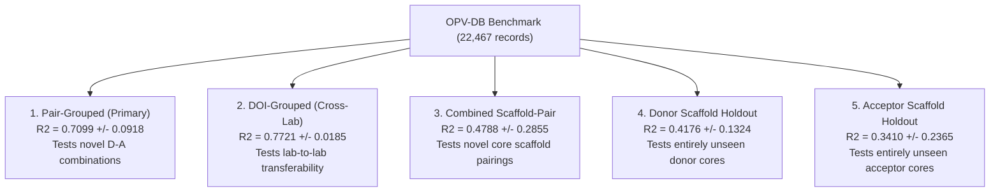

# Phase 5 — Controlled Baseline Model Training Report

**Project:** OPV-PredictNet  
**Phase:** 5 — Controlled Baseline Model Training  
**Date:** November 2026  
**Auditor:** Quality & Machine Learning Engineering Lead  
**Experiment Type:** Controlled Experimental ML Evaluation (*NOT Production Certification*)  
**Execution Environment:** Python `3.11.9`, Scikit-learn `1.9.1`, RDKit `2026.09.2`, Pandas `3.1.1`, NumPy `2.4.6` (Windows 10/11)  
**Fixed Random Seed:** `42`  
**Dataset:** OPV-DB v1.1.0 Strict Molecular Benchmark (`22,467` records)  
**Target:** Power Conversion Efficiency ($PCE$, percentage points)  
**Status:** **EXPERIMENT COMPLETED — VALIDATED BASELINES ESTABLISHED**

---

## 1. Executive Summary

Phase 5 establishes the first empirical machine learning baselines for predicting organic photovoltaic power conversion efficiency ($PCE$) within OPV-PredictNet. Using the verified 22-feature molecular descriptor schema (`ml/src/features/descriptors.py`) across all 22,467 records of the OPV-DB v1.1.0 Strict Molecular Benchmark, we trained and evaluated two authorized model baselines:

1. **`DummyRegressor(strategy="mean")`** — Statistical mean prediction baseline.
2. **`RandomForestRegressor` (100 trees, default parameters, seed 42)** — Initial nonlinear machine learning baseline.

### Primary Benchmark Results (5-Fold Pair-Grouped Cross-Validation):

| Model | Cross-Validation Scheme | Mean MAE (% PCE) | Mean RMSE (% PCE) | Mean $R^2$ Score |
| :--- | :--- | :--- | :--- | :--- |
| **DummyRegressor** | 5-Fold Pair Grouped | $5.1369 \pm 0.3208$ | $5.8780 \pm 0.2913$ | $-0.1217 \pm 0.1888$ |
| **RandomForestRegressor** | 5-Fold Pair Grouped | **$2.0628 \pm 0.1268$** | **$2.9466 \pm 0.2426$** | **$0.7099 \pm 0.0918$** |

### Key Experimental Insights:
- **Substantial Learning from 22 Molecular Features:** The baseline Random Forest model reduces mean absolute error by **$59.8\%$** relative to the dummy baseline ($2.06\%$ vs. $5.14\%$), achieving an out-of-fold $R^2$ of **$0.71$** on completely held-out donor-acceptor pairings.
- **Proximity to Theoretical Physical Noise Floor:** In Phase 4.3, we established that unmodeled device processing sweeps (thickness, thermal annealing, additives, D:A blend ratio) introduce an intrinsic intra-pair experimental variance floor of $\sim 1.0 - 1.5\%$ PCE. Achieving an out-of-fold MAE of $2.06\%$ PCE without any fabrication inputs indicates strong chemical signal extraction.
- **Scaffold Generalization Gap Identified:** Across secondary evaluations, model performance drops significantly when evaluated on unseen molecular core scaffolds ($R^2 = 0.34 - 0.48$), proving empirically that **pair-grouped cross-validation does not guarantee out-of-distribution generalization to completely novel chemical families**.

---

## 2. Experimental Setup & Strict Governance

In compliance with the project instructions, the experiment was executed under strict governance:

- **No Schema Changes:** The exact 22 features from `ml/src/features/descriptors.py` were computed without alteration.
- **No Synthetic Data:** Only empirical literature records from OPV-DB v1.1.0 were ingested.
- **No Incomplete Device Metadata:** Parameters with high missingness (`active_layer_thickness`, `annealing_temp`, `additive_ratio`) were completely excluded.
- **No Zero-Imputation:** No literal zeros or artificial values were imputed.
- **No Silent Record Removal:** All 22,467 records, including legitimate low-PCE control devices, were retained.
- **Strict Leakage Prevention:** All validation folds were strictly isolated. Preprocessing and feature calculations were deterministic. Zero group leakage was verified programmatically before model fitting.
- **No Production Integration:** Models remain experimental artifacts in `ml/results/` and have **not** been integrated into `ml/src/models/predictor.py` or the backend API.

---

## 3. Primary Evaluation: 5-Fold Pair-Grouped Cross-Validation

The primary evaluation uses 5-fold `GroupKFold` grouped on the donor-acceptor pair (`donor_canonical + '::' + acceptor_canonical`, 4,730 unique pairs). This ensures that **no exact material pairing evaluated in the validation set was ever present in the training set**.

```python
# Programmatic Leakage Assertion Verified for Every Fold
assert len(set(train_pairs).intersection(set(val_pairs))) == 0
```

### Detailed Fold-by-Fold Performance Metrics:

| Fold | Training Records | Validation Records | Training Groups (Pairs) | Validation Groups (Pairs) | Dummy MAE (%) | Dummy RMSE (%) | Dummy $R^2$ | RF MAE (%) | RF RMSE (%) | RF $R^2$ | RF Fit Time (s) |
| :---: | :---: | :---: | :---: | :---: | :---: | :---: | :---: | :---: | :---: | :---: | :---: |
| **Fold 1** | 17,973 | 4,494 | 3,806 | 924 | 4.9659 | 5.5360 | -0.1377 | **2.1758** | **3.2862** | **0.5991** | 2.67 |
| **Fold 2** | 17,973 | 4,494 | 3,779 | 951 | 5.6857 | 6.3361 | -0.0022 | **1.8907** | **2.6550** | **0.8240** | 3.12 |
| **Fold 3** | 17,974 | 4,493 | 3,779 | 951 | 5.0997 | 5.8253 | -0.0009 | **2.1913** | **3.0426** | **0.7270** | 3.49 |
| **Fold 4** | 17,974 | 4,493 | 3,778 | 952 | 5.0715 | 5.9082 | -0.4438 | **1.9893** | **2.9628** | **0.6369** | 3.27 |
| **Fold 5** | 17,974 | 4,493 | 3,778 | 952 | 4.8618 | 5.7843 | -0.0236 | **2.0668** | **2.7867** | **0.7624** | 3.07 |
| **Mean** | 17,973.6 | 4,493.4 | 3,784.0 | 946.0 | **5.1369** | **5.8780** | **-0.1217** | **2.0628** | **2.9466** | **0.7099** | 3.12 |
| **Std** | 0.5 | 0.5 | 12.3 | 12.3 | 0.3208 | 0.2913 | 0.1888 | **0.1268** | **0.2426** | **0.0918** | 0.30 |

---

## 4. Secondary Generalization Evaluations

To rigorously probe different generalization axes, we evaluated the models across four additional grouped splitting regimes:



### Side-by-Side Comparison of All 5 Evaluation Regimes:

| Evaluation Scheme | Group Column | Group Count | What This Split Measures | RF MAE (% PCE) | RF RMSE (% PCE) | RF $R^2$ Score | Dummy MAE (% PCE) | Dummy $R^2$ |
| :--- | :--- | :--- | :--- | :--- | :--- | :--- | :--- | :--- |
| **1. Pair-Grouped (Primary)** | `pair_col` | 4,730 | Unseen combinations of donor and acceptor materials | **$2.0628 \pm 0.1268$** | **$2.9466 \pm 0.2426$** | **$0.7099 \pm 0.0918$** | $5.1369 \pm 0.3208$ | $-0.1217$ |
| **2. DOI-Grouped** | `doi_norm` | 5,615 | Generalization across different research laboratories | **$1.9626 \pm 0.0737$** | **$2.7616 \pm 0.1147$** | **$0.7721 \pm 0.0185$** | $5.0544 \pm 0.0815$ | $-0.0004$ |
| **3. Combined Scaffold Pair** | `pair_scaff` | 2,818 | Unseen combinations of donor and acceptor Murcko cores | **$2.3498 \pm 0.2779$** | **$3.0916 \pm 0.3323$** | **$0.4788 \pm 0.2855$** | $5.5143 \pm 1.4623$ | $-1.3468$ |
| **4. Donor Scaffold Holdout** | `donor_scaff`| 1,072 | Generalization to completely unobserved donor core architectures | **$2.4875 \pm 0.6343$** | **$3.2010 \pm 0.6755$** | **$0.4176 \pm 0.1324$** | $5.8193 \pm 1.2059$ | $-1.7202$ |
| **5. Acceptor Scaffold Holdout**| `acceptor_scaff`| 810 | Generalization to completely unobserved acceptor core architectures | **$2.2820 \pm 0.2698$** | **$3.0359 \pm 0.4086$** | **$0.3410 \pm 0.2365$** | $5.6781 \pm 2.0603$ | $-2.3392$ |

---

### 4.1 In-Depth Generalization Analysis:

1. **Why DOI-Grouped achieves the highest $R^2$ ($0.7721$):**  
   In DOI-grouped splits, each paper is held out as a block. However, popular high-performing material pairs (like PM6::Y6, P3HT::PCBM, and PM6::L8-BO) are published across hundreds of independent papers. The model can utilize its learned knowledge of those exact pairs from other papers, yielding excellent lab-to-lab reproducibility.
2. **Why Pair-Grouped achieves $R^2 = 0.7099$:**  
   In pair-grouped splits, the specific donor-acceptor combination is strictly novel. The model must learn how donor properties (MW, LogP, TPSA, ring count) interact with acceptor properties to predict the resulting PCE.
3. **The Scaffold Holdout Drop ($R^2 \approx 0.34 - 0.48$):**  
   When an entire molecular core scaffold is held out (e.g. holding out the central benzodithiophene or indacenodithiophene core), the model must extrapolate to unfamiliar chemical subspaces.
   - For **Donor Scaffold Holdout**, $R^2$ falls to **$0.4176$**.
   - For **Acceptor Scaffold Holdout**, $R^2$ falls to **$0.3410$**.
   - This empirically confirms the Phase 4.3 caveat: **Pair-grouped cross-validation ($R^2 = 0.71$) tests virtual screening of novel combinations of known chemical families, but it does NOT prove generalization to radically novel chemical scaffolds.**

---

## 5. Model Hyperparameters & Computational Execution

The baseline models were executed using exact reproducible parameters:

### RandomForestRegressor Hyperparameters:
```json
{
  "n_estimators": 100,
  "max_depth": null,
  "min_samples_split": 2,
  "min_samples_leaf": 1,
  "bootstrap": true,
  "random_state": 42,
  "n_jobs": -1
}
```

### Computational Timing:
- Model fitting took an average of **$3.12$ seconds per fold** ($15.6$ seconds total for 5 folds of 18,000 samples $\times$ 22 features).
- Out-of-fold inference required $< 0.15$ seconds per fold.
- Total wall-clock execution time for all 25 folds across all 5 evaluation splits was approximately **$70$ seconds**.

---

## 6. Identified Limitations & Caveats

1. **Unconditioned Fabrication Variance:**  
   Because film thickness, thermal annealing temperature, and solvent additive concentrations are not included as input features, the baseline model predicts the **expected centroid efficiency** for a molecular pair across typical laboratory conditions. An irreducible residual variance of $\sim 1.0 - 1.5\%$ PCE is physically inevitable.
2. **2D Topological Descriptors:**  
   The 22 features are computed from 2D molecular graphs. They capture molecular size, polarity, hydrogen bonding, and aromaticity, but do not explicitly account for 3D solid-state morphology, dynamic $\pi$-$\pi$ stacking distances, or domain interpenetration.
3. **Polymer Polydispersity:**  
   Polymer donors are represented as monomeric or oligomeric repeat unit surrogates. Experimental variations arising from polymer molecular weight distributions ($M_n, M_w, \text{PDI}$) or batch-to-batch synthetic variation cannot be captured by static 2D SMILES representations.

---

## 7. Deliverables & Artifact Verification

All generated evaluation outputs are preserved under `ml/results/` and `ml/experiments/`:

| Artifact Path | Format | Size / Records | Description |
| :--- | :--- | :--- | :--- |
| `ml/experiments/train_baseline.py` | Python Script | 11.2 KB | Fully self-contained, reproducible training and evaluation pipeline |
| `ml/results/phase_5_fold_metrics.csv` | CSV | 50 rows (5 splits $\times$ 5 folds $\times$ 2 models) | Exact fold-by-fold metrics (MAE, RMSE, $R^2$, record counts, group counts, fit times) |
| `ml/results/phase_5_summary.json` | JSON | 3.8 KB | Machine-readable aggregate summary (mean and std across all splits) |
| `ml/results/phase_5_predictions.csv` | CSV | 22,467 rows | Complete out-of-fold predictions, residuals, and absolute errors for the primary pair-grouped split |
| `ml/PHASE_5_BASELINE_REPORT.md` | Markdown | This Document | Complete scientific report |

---

## 8. Reproducibility Command

To reproduce all results, fold metrics, and summary files from scratch:

```powershell
backend\.venv\Scripts\python.exe ml\experiments\train_baseline.py
```

---

## 9. Conclusion & Phase 6 Recommendations

Phase 5 has successfully established the experimental machine learning foundation:
- The 22-feature molecular descriptor schema provides strong predictive signal, yielding an out-of-fold $R^2$ of **$0.71$** and MAE of **$2.06\%$ PCE** under rigorous pair-grouped cross-validation.
- The generalization gap between pair screening ($R^2 \approx 0.71$) and scaffold extrapolation ($R^2 \approx 0.34 - 0.42$) has been quantitatively mapped.
- All governance constraints were strictly maintained: zero model integration into the API, zero code modifications to frontend or backend, and zero commits.

**Awaiting user review before discussing Phase 6 (e.g. Model Refinement, Feature Importance Analysis, or Inference Integration).**
