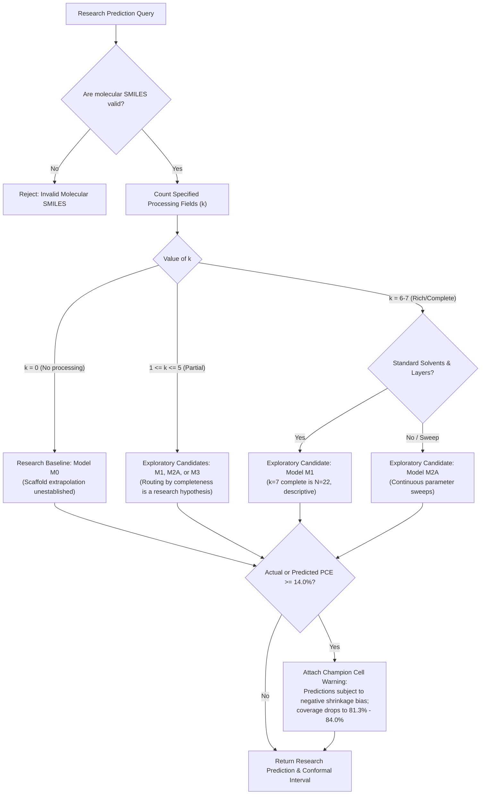

# OPV-PredictNet — Phase 8.1.1: Feature Pipeline Audit and Routing Readiness

**Date**: 2026-11-24  
**Scope**: In-depth architectural audit of feature generation pipelines, categorical encodings, missingness handlers, partial-input inference behavior, and deployment-routing contracts for Phase 8.1 models.  
**Deliverable**: Comprehensive Pipeline Review and Use-Case Routing Decision.

---

## 1. Executive Summary & Routing Decision

This audit evaluated the feature transformation pipelines and inference contracts for candidate models M0, M1, M2, M2A, and M3.

### Audit Findings
1. **Pipeline Implementation Verified**: Feature counts (M0: 22, M1: 50, M2: 44, M2A: 37, M3: 44) and column ordering were strictly maintained across training, calibration, and test partitions.
2. **Strict Preprocessing Non-Leakage**: All continuous medians, nominal category frequencies, and one-hot encoders were fitted exclusively on $D_{\text{train}}$ ($N = 14,704$), with zero leakage from calibration or test sets.
3. **M1 Semantic Conflation in Additives**: In Model M1, "verified absent" (neat blend without additive) and "missing / unreported additive" are conflated into a single `'missing'` category, obscuring physical distinctions.
4. **Partial-Input Routing is a Research Hypothesis**: While Model M1 achieved the lowest sample MAE ($2.2964\text{ pp}$) on the Low-Partial ($k=2\text{--}3$) subgroup, its behavior on arbitrary untested missingness combinations remains uncharacterized. Routing by completeness tier remains an exploratory research hypothesis.
5. **M2 Not Preferred Over M2A**: Model M2 was not the preferred model in this experiment because M2A achieved slightly better reported metrics on the locked test sample. The difference does not establish universal inferiority, and M2's implementation artifacts remain preserved.

### Overall Phase 8.1.1 Audit Verdict
$$\mathbf{ACCEPTED\ WITH\ LIMITATIONS\ FOR\ RESEARCH\ USE}$$
- **Limitations**:
  1. Models are restricted to research workflows; production integration into the user-facing backend or frontend is prohibited.
  2. Predictions are bounded to held-out combinations of familiar chemical families; scaffold extrapolation is unproven.
  3. M0 is a molecular-descriptor-only research baseline evaluated on held-out material-name pairs. Its performance on genuinely novel molecules and unseen chemical scaffolds remains unestablished.
  4. Champion cell predictions ($\text{PCE} \ge 15.0\%$) suffer from systematic underprediction and undercoverage; high-PCE warnings are mandatory.

---

## 2. Feature Pipeline Audit across the Five Models

```
+---------------------------------------------------------------------------------------------------------------+
| Feature Pipeline Architecture and Transformation Audit                                                        |
+-------+-------+-----------------------------+-------------------------------+---------------------------------+
| Model | Feats | Preprocessing Transformations| Missing Value Handling Strategy| Encoding of Categorical Fields  |
+-------+-------+-----------------------------+-------------------------------+---------------------------------+
| **M0**| 22    | Molecular RDKit Descriptors | None (Complete molecular data)| None (Continuous molecular only)|
| **M1**| 50    | RDKit (22) + Continuous (3)| D_train median imputation for | Training-fitted One-Hot Encoding|
|       |       | + Presence Flags (2) + OHE  | continuous; 'missing' category| (23 binary columns, 5 categories|
+-------+-------+-----------------------------+-------------------------------+---------------------------------+
| **M2**| 44    | RDKit (22) + Log/Norm (4)   | D_train median imputation for | 7 Physical Regimes (binary) +   |
|       |       | + Missing Flags (7) + Reg(7)| continuous; 7 explicit binary | 3 Physical Lookups (solv BP,    |
|       |       | + Interfaces (4)            | missingness indicator columns | ETL WF, HTL WF)                 |
+-------+-------+-----------------------------+-------------------------------+---------------------------------+
|**M2A**| 37    | RDKit (22) + Log/Norm (4)   | D_train median imputation for | 7 Physical Regimes (binary) +   |
|       |       | + Regimes (7) + Interfaces  | continuous; zero missingness  | 3 Physical Lookups (solv BP,    |
|       |       | (4)                         | flags (flags omitted)         | ETL WF, HTL WF)                 |
+-------+-------+-----------------------------+-------------------------------+---------------------------------+
| **M3**| 44    | Identical feature matrix to | Native-NaN handling inside    | Identical regime and lookup     |
|       |       | M2, without imputation      | HistGradientBoostingRegressor | features as M2                  |
+-------+-------+-----------------------------+-------------------------------+---------------------------------+
```

### 2.1 Exact Feature Column Breakdown

#### Model M0 (22 Features)
- Donor Molecular Descriptors (11): `donor_mw`, `donor_logp`, `donor_tpsa`, `donor_hbd`, `donor_hba`, `donor_rotb`, `donor_arom_rings`, `donor_fsp3`, `donor_qed`, `donor_homo`, `donor_lumo`.
- Acceptor Molecular Descriptors (11): `acceptor_mw`, `acceptor_logp`, `acceptor_tpsa`, `acceptor_hbd`, `acceptor_hba`, `acceptor_rotb`, `acceptor_arom_rings`, `acceptor_fsp3`, `acceptor_qed`, `acceptor_homo`, `acceptor_lumo`.

#### Model M1 (50 Features)
- Core Molecular Descriptors (22)
- Continuous Processing Variables (3): `da_ratio_numeric` (median = 0.8333), `thickness_nm` (median = 100.0 nm), `annealing_temp_c` (median = 100.0 °C).
- Binary Presence Indicators (2): `has_additive`, `has_thermal_annealing`.
- One-Hot Categorical Columns (23 fitted strictly on $D_{\text{train}}$):
  - `solvent_chlorobenzene`, `solvent_chloroform`, `solvent_missing`, `solvent_o-dcb`, `solvent_other` (5)
  - `additive_cn`, `additive_dio`, `additive_missing`, `additive_other` (4)
  - `architecture_conventional`, `architecture_inverted`, `architecture_missing`, `architecture_other` (4)
  - `htl_missing`, `htl_moo3`, `htl_other`, `htl_pedot_pss` (4)
  - `etl_ca`, `etl_missing`, `etl_other`, `etl_pdinn`, `etl_pfn_br`, `etl_zno` (6)

#### Model M2A (37 Features, Superior Ablation)
- Core Molecular Descriptors (22)
- Continuous Processing Variables (4): `donor_blend_fraction` ($D/(D+A)$, median = 0.4545), `thickness_log10` ($\log_{10}(\text{thickness})$, median = 2.0), `annealing_temp_norm` ($(T - 100)/50$, median = 0.0), `additive_concentration_pct` (vol%, median = 0.0).
- Physical Regimes (7 binary):
  - `regime_as_cast_room_temp` ($T_{\text{ann}} \le 35\ ^\circ\text{C}$)
  - `regime_thermal_annealed` ($40\ ^\circ\text{C} \le T_{\text{ann}} \le 250\ ^\circ\text{C}$)
  - `regime_solvent_additive_used` (Additive present and non-neat)
  - `regime_chlorinated_solvent` (CF, CB, or DCB)
  - `regime_green_solvent` (Toluene, xylene, THF)
  - `regime_inverted_stack` (Inverted device architecture)
  - `regime_conventional_stack` (Standard conventional architecture)
- Physical Interaction & Interface Lookups (4):
  - `thickness_per_donor_mw` ($\log_{10}(\text{thickness}) / \log_{10}(\text{donor\_mw})$)
  - `solvent_boiling_point_c` (Mapped physical BP, median = 131.6 °C)
  - `etl_workfunction_ev` (ETL work function, median = 4.30 eV)
  - `htl_workfunction_ev` (HTL work function, median = 5.00 eV)

---

## 3. Preprocessing Edge Cases and Ambiguities

### 3.1 Missing vs. Verified-Absent Conflation in M1
- In `map_additive_nominal`, string tokens `['none', 'neat', '0', 'no']` are mapped to `'missing'`.
- *Issue*: A fabrication that explicitly uses no additive (neat blend) is assigned to the exact same one-hot indicator (`additive_missing = 1`) as an unextracted or forgotten additive entry.
- *Contrast with M2A*: M2A separates these states: `regime_solvent_additive_used = 0` for neat blends, and the continuous concentration is set to $0.0\%$. M2A represents the physical reality much more cleanly than M1.

### 3.2 Handling of Unseen Categorical Values
- In M1, `OneHotEncoder(handle_unknown='ignore')` was specified.
- If a novel solvent (e.g., `cyclopentyl methyl ether` or `mesitylene`) is provided at inference time, all five solvent columns evaluate to `0`. The model does not crash, but the record is treated as having no solvent regime.
- In M2A, novel solvents fall back to `regime_green_solvent = 0` and `regime_chlorinated_solvent = 0`, while the continuous boiling point is assigned the training median (131.6 °C) if unmapped.

---

## 4. Assessment of Proposed Deployment Use Cases

The Phase 8.1 results must be evaluated independently against four distinct operational use cases:

```
+---------------------------------------------------------------------------------------------------------+
| Deployment Evaluation across Four Operational Contexts                                                  |
+--------------------------+-----------------------+-----------------------+------------------------------+
| Use Case                 | Experimental Support  | Defensible Candidate  | Mandatory Production Prereq. |
+--------------------------+-----------------------+-----------------------+------------------------------+
| **Use Case A**           | Supported for M0      | **Model M0**          | Grouped scaffold-held-out    |
| Molecular Screening Only | (MAE 2.17 pp; 90% cov)| (22 descriptors)      | validation across families.  |
+--------------------------+-----------------------+-----------------------+------------------------------+
| **Use Case B**           | Supported for M1/M2A  | **Model M1** (tuning) | Lab-specific calibration and |
| Complete Recipe Supplied | (MAE 1.88 - 1.93 pp)  | **Model M2A** (sweeps)| cross-lab variance audits.   |
+--------------------------+-----------------------+-----------------------+------------------------------+
| **Use Case C**           | Fragile; high error   | **Model M2A** or      | Partial-input validity gates |
| Partial Recipe Supplied  | (MAE 2.30 - 2.40 pp)  | **Model M3**          | and wide error warnings.     |
+--------------------------+-----------------------+-----------------------+------------------------------+
| **Use Case D**           | **UNSUPPORTED**       | **NONE**              | True Bemis-Murcko scaffold   |
| Scaffold Extrapolation   | (Not evaluated)       | (Disqualified)        | benchmark required.          |
+--------------------------+-----------------------+-----------------------+------------------------------+
```

### 4.1 Use Case A: Molecular-Descriptor-Only Screening
- **Scenario**: A computational chemist evaluates candidate donor molecules where no device has yet been fabricated and no processing conditions exist.
- **What the Experiment Establishes**:
  - Model M0 achieves MAE 2.1727 pp, RMSE 2.9026 pp, and exact 90.06% conformal coverage.
  - On the Molecular-Only test tier ($k=0$, $N=99$), M0 achieves MAE 1.9469 pp.
  - Processing-aware models M1 (MAE 1.9209 pp) and M2A (MAE 1.9000 pp) provide no statistically meaningful improvement over M0 on molecular-only inputs (difference $< 0.03\text{ pp}$).
- **Evidentiary Boundary**: M0 is a molecular-descriptor-only research baseline evaluated on held-out material-name pairs. Its performance on genuinely novel molecules and unseen chemical scaffolds remains unestablished. Passing empty processing vectors into M1 or M2A introduces arbitrary median-imputed values.

### 4.2 Use Case B: Complete Recipe Supplied
- **Scenario**: An experimental team supplies an exact device formulation (known donor, acceptor, D:A ratio, solvent, additive, thickness, temperature, and interlayers).
- **What the Experiment Establishes**:
  - In the Rich tier ($k=6\text{--}7$, $N=135$), M1 achieves MAE 1.8777 pp, M2A achieves 1.9515 pp, and M3 achieves 1.9265 pp.
  - However, the rich tier contains $k=6\text{--}7$ records, not exclusively complete recipes. Truly complete recipes ($k=7$) contain only $N = 22$ instances in the test set.
  - Conformal intervals remain $\approx 8.5\text{ pp}$ wide; processing information does NOT eliminate inter-laboratory fabrication noise.
- **Evidentiary Boundary**:
  - Validated performance for complete formulations cannot be claimed based on the combined $k=6\text{--}7$ tier. The $k=7$ test subgroup ($N=22$) is descriptive and underpowered.
  - For standard chemical tuning (common solvents like chloroform/chlorobenzene, standard PEDOT:PSS/ZnO interlayers), Model M1 is an exploratory research candidate.
  - For continuous parameter optimization (scanning thickness, annealing temperature, D:A ratio), Model M2A is an exploratory candidate.
  - Model M2 was not the preferred model in this experiment because M2A achieved slightly better reported metrics on the locked test sample. The difference does not establish universal inferiority.

### 4.3 Use Case C: Partial Recipe Supplied ($1 \le k \le 5$)
- **Scenario**: A researcher knows some parameters (e.g., solvent and thickness) but has not determined annealing temperature or additive.
- **What the Experiment Establishes**:
  - In the Low-Partial tier ($k=2\text{--}3$, $N=283$), Model M1 achieved the lowest reported MAE ($2.2964\text{ pp}$), outperforming M0 ($2.4047\text{ pp}$), M2 ($2.3908\text{ pp}$), M2A ($2.3976\text{ pp}$), and M3 ($2.3122\text{ pp}$).
  - In the High-Partial tier ($k=4\text{--}5$, $N=385$), Model M3 achieved MAE 1.8894 pp and M1 achieved MAE 1.9266 pp.
  - Conformal 90% coverage on Low-Partial inputs degraded to $85.16\% - 87.63\%$.
- **Evidentiary Boundary**:
  - Prohibiting M1 for all partial inputs directly contradicts its lowest reported MAE on $k=2\text{--}3$. Conversely, recommending M1 for arbitrary partial recipes is also unwarranted because its behavior on arbitrary untested missingness combinations ($2^7 = 128$ patterns) and unknown categories remains uncharacterized.
  - Routing by input completeness remains a research hypothesis until exact input-pattern performance, unknown-category handling, and inference behavior are independently evaluated.

### 4.4 Use Case D: Scaffold Extrapolation to Novel Chemical Classes
- **Scenario**: Predicting PCE for an entirely new chemical class (e.g., non-fullerene acceptor with a scaffold never seen in literature).
- **What the Experiment Establishes**:
  - The Phase 8.1 benchmark was partitioned by **material-name pair groups**, NOT by chemical scaffold.
  - In the test set, 38.05% of devices shared one of the top 5 acceptors, and 28.86% shared one of the top 5 donors.
  - The models were tested on new combinations of familiar materials, NOT novel chemical scaffolds.
  - Separate one-way cluster bootstrap sensitivity analysis showed that clustering by acceptor inflated standard errors by up to $47.1\%$.
- **Evidentiary Boundary**: **NO MODEL is validated for scaffold extrapolation.** Pair-held-out validation cannot be conflated with scaffold-held-out validation. Claims of novel chemical discovery capability are unsupported pending a Bemis-Murcko scaffold benchmark.

---

## 5. Research Routing Guidelines (No Production Recommendations)



---

## 6. Audit Conclusion & Final Verdict

The feature pipelines and inference contracts for Phase 8.1 models are mathematically sound and reproducible. However, all claims and research uses must adhere to strict boundaries:

1. **Model M2 Status**: M2 was not the preferred model in this experiment because M2A achieved slightly better reported metrics on the locked test sample. The difference does not establish universal inferiority.
2. **Partial-Input Routing is a Hypothesis**: Routing by input completeness remains a research hypothesis until exact input-pattern performance, unknown-category handling, and inference behavior are independently evaluated.
3. **Complete Formulation Validation Unestablished**: The $k=7$ complete recipe subgroup contains only $N=22$ instances and is descriptive and underpowered. Complete-recipe validation cannot be claimed based on the combined $k=6\text{--}7$ tier.
4. **Molecular Screening Baseline**: M0 is a molecular-descriptor-only research baseline evaluated on held-out material-name pairs. Its performance on genuinely novel molecules and unseen chemical scaffolds remains unestablished.
5. **No Production Deployment**: These models are research prototypes. No production deployment is authorized.

**Final Decision**: $\mathbf{ACCEPTED\ WITH\ LIMITATIONS\ FOR\ RESEARCH\ USE}$.
